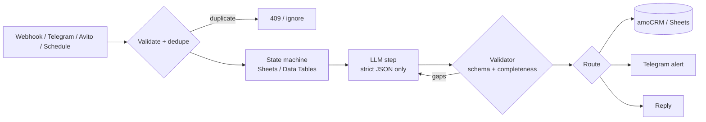

# n8n LLM Automation Patterns

**Fourteen months of putting LLMs inside real business automations, distilled: 13 importable n8n workflows that show the patterns that survived, plus one production automation with its source, its test harness and fictional data. The rule behind all of them: deterministic rails for the flow, the model only where a decision or language is needed.**

| | |
|---|---|
| **Body of work** | 116 workflows, 2,147 nodes and 40+ external services built between mid-2025 and 2026 (Telegram, Avito, amoCRM, Google Workspace, Apify, Pinecone, OpenAI, Anthropic and more) |
| **In this repository** | 13 curated workflows with secrets removed, and one production automation with tests |
| **Models** | GPT-4o-mini for bulk classification, Claude Sonnet for generation, Claude Opus only as a repair escalation, cheap GPT models for routing and JSON fixes |
| **Trajectory** | Hand-built in the n8n editor -> a system of n8n workflows that generates n8n workflows -> Claude Code building workflows through the n8n MCP server |

---

## The patterns



1. **Rails for the flow, the model for the decision.** Dialogs are state machines; the model receives only the final fields and returns strict JSON such as `{status, reason, tip}`. Behaviour is predictable, every decision is auditable and each call is cheap.
2. **Validate what the model returns.** Extraction runs in two passes (structured, then gap filling) followed by a completeness validator, so a record is either complete or says exactly what is missing.
3. **Duplicate-safe intake.** One webhook for several sources, phone-based deduplication with a proper HTTP 409, then CRM, log and alert. No double deals.
4. **Test without production.** Test modes with mocked payloads, and in the generator a tester that mocks every external node.
5. **Pick the model by job and cost.** Bulk work goes to the cheapest model that is good enough; expensive models are an escalation path, not the default.

## Catalog

| Workflow | What it does | Patterns |
|---|---|---|
| [`avito-lead-qualifier`](workflows/avito-lead-qualifier.json) | Answers every new Avito chat, keeps per-chat context, scores the lead with an LLM and alerts on Telegram only when it is worth a human. Built for my own freelance practice on the native Avito Messenger API (OAuth), replacing a paid relay | state per chat, strict-JSON scoring, loop protection |
| [`unified-lead-intake-amocrm`](workflows/unified-lead-intake-amocrm.json) | One webhook for a bot and a website: normalise, validate the phone, search duplicates, create the amoCRM deal, log, notify; answers 200, 400 or 409 | duplicate-safe intake, explicit HTTP contract |
| [`tars-orchestrator`](workflows/tars-orchestrator.json) + 4 agents | TARS, a personal assistant: an orchestrator agent with memory that delegates to email, calendar, contacts and content sub-agents, plus web search and a calculator | multi-agent orchestration via sub-workflows as tools |
| [`freelance-demand-analysis`](workflows/freelance-demand-analysis.json) | Scraped 339 automation orders from three freelance exchanges (Apify), cleaned and batched them, classified with GPT-4o-mini at about one cent per 163 records, and rolled them up into median price and automatable share per category | batch classification, cost-aware model choice |
| [`dental-clinic-blog-writer`](workflows/dental-clinic-blog-writer.json) | Demo copywriter agent for a dental clinic: writes expert blog articles in the clinic's house style from a vector store of reference material and saves drafts to Google Docs | RAG agent with tools |
| [`interview-analysis-agent`](workflows/interview-analysis-agent.json) | A new recording in Google Drive is transcribed with Whisper, analysed by an agent with web search, and written up in Google Docs | event-driven transcription pipeline |
| [`builder-v2-orchestrator`](workflows/builder-v2-orchestrator.json), [`builder-v2-7-stage-generator`](workflows/builder-v2-7-stage-generator.json), [`builder-v2-tester`](workflows/builder-v2-tester.json) | "A robot that builds robots": describe a task in Telegram, the orchestrator retrieves a proven template from a vector store or a 99-node generator plans, generates, validates in 6 layers (schema, types, connections, DAG, parameters, logic) and repairs a new workflow; the tester scores it 0 to 100 with mocked runs | RAG over templates, layered validation, Sonnet -> Opus repair escalation, platform as ground truth |

The Builder line later moved out of n8n into Python and the Claude Agent SDK; see [agentic-n8n-workflow-builder](https://github.com/AverageCargo87/agentic-n8n-workflow-builder). Two lessons from the n8n version carried over: prefetch the few node schemas the model needs instead of letting it browse (it was burning 50 to 80K tokens per generation wandering through MCP), and treat the n8n API as the judge of validity: upload, see if n8n accepts it, delete.

## In production: staff birthday digest

[`automations/staff-birthday-digest`](automations/staff-birthday-digest) runs every morning for a public school with about 500 staff: it reads the HR system's Excel export, finds birthdays today and in three days, and emails the director, or sends an alarm if the file cannot be read.

- **Built through the n8n Workflow SDK and the n8n MCP server**, not by hand: `workflow.sdk.js` defines the workflow in code, and every node was checked with `validate_node_config`, the whole workflow with `validate_workflow`, and a run with `test_workflow` before activation.
- **Columns are found by their headers**, so a re-ordered export does not break it.
- **Edge cases handled in `code_node.js`:** dates as ISO strings, `dd.mm.yyyy` or Excel serials; people born on 29 February are congratulated on the 28th in non-leap years; correct Russian plural endings for ages; milestone birthdays from 50 flagged; no email on days without birthdays.

```bash
cd automations/staff-birthday-digest
node tools/test_code_node.mjs     # runs the Code node outside n8n on a fictional export
```

## Using these workflows

Import any JSON file into n8n (Workflows -> Import from file). Credentials are not included: attach your own in each node. Every secret and identifier was replaced with a placeholder such as `<OPENAI_API_KEY>`, `<CLIENT_SECRET>`, `<DOCUMENTID>`, `<AVITO_ACCOUNT_ID>` or `user@example.com`; search for `<` to find what needs filling in.

## Notes

- Most workflows here are prototypes and demos; the production automations are the birthday digest and client bots that are not published.
- Node names, prompts and messages are mostly in Russian.
- Client workflows built for other businesses are deliberately excluded.

## License

MIT
